# Count on Me — Calorie Tracker

A native iOS calorie, macro, water, weight, and exercise tracker built with SwiftUI and SwiftData. Food can be logged manually, by browsing a local food library, by scanning a barcode (Open Food Facts), by taking/uploading a photo (Gemini vision), by voice (on-device speech-to-text + Gemini), or by free-text description (Gemini).

## Screenshots

App appearance follows the system by default and can be pinned to Light or Dark in **More → Appearance**.

| Home | Tracker | Insights |
|---|---|---|
| 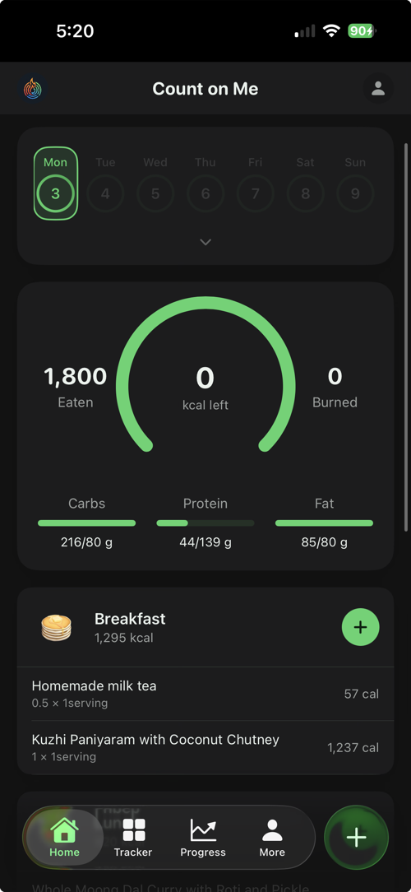 | 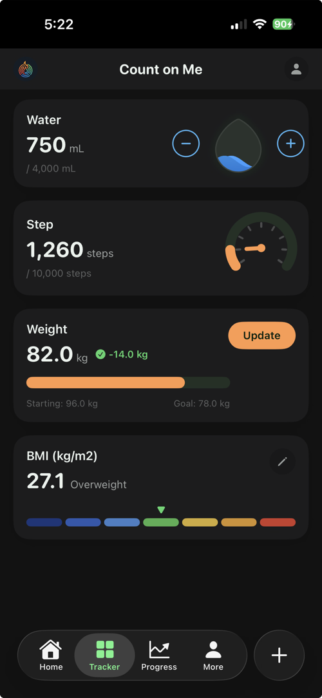 | 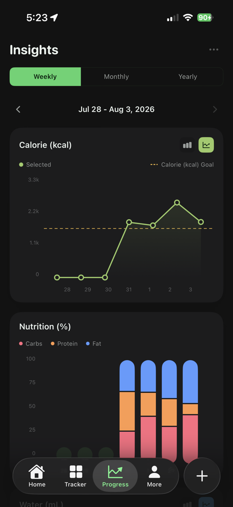 |
| 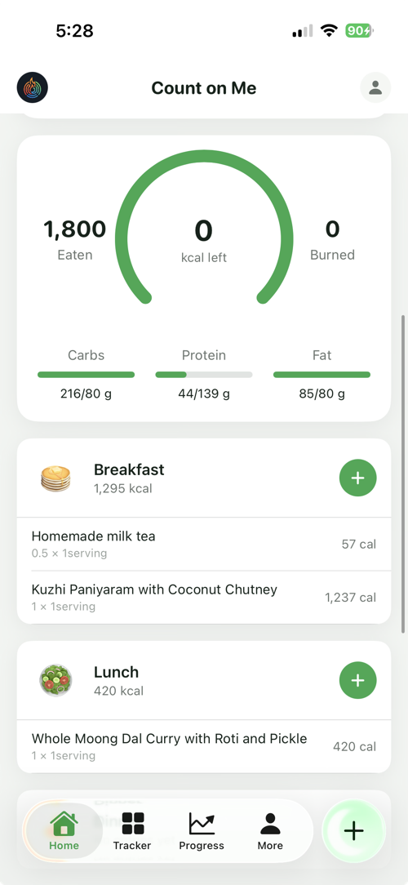 | 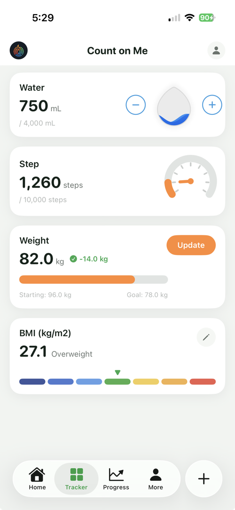 | 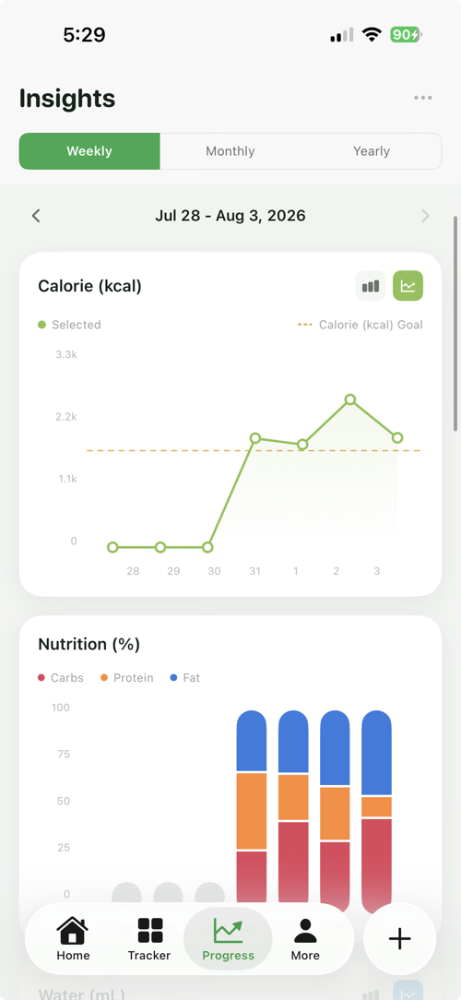 |

| Quick Log | Browse foods | Profile |
|---|---|---|
| 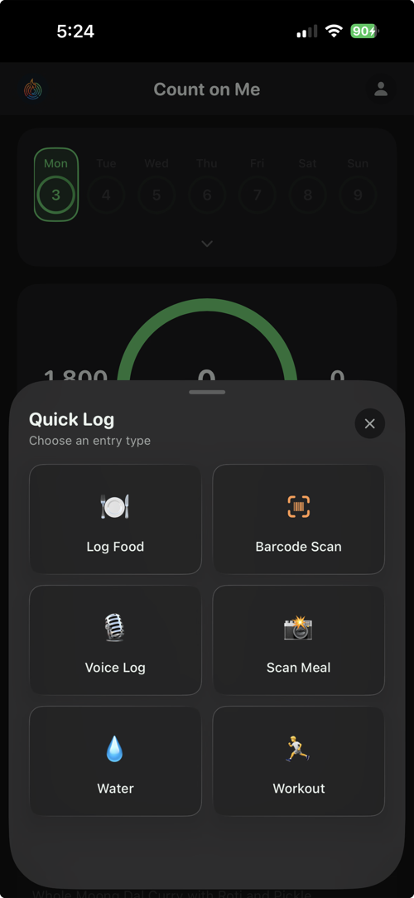 | 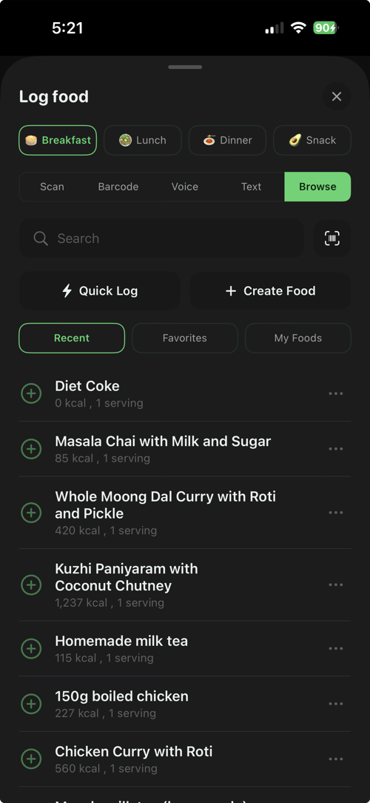 | 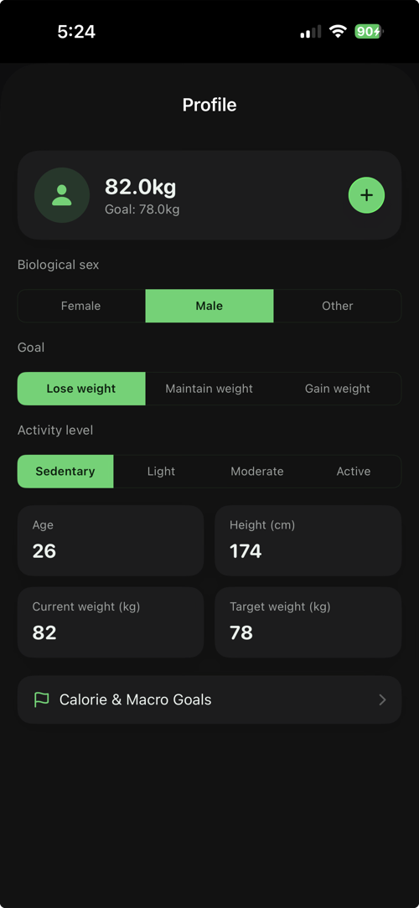 |
| 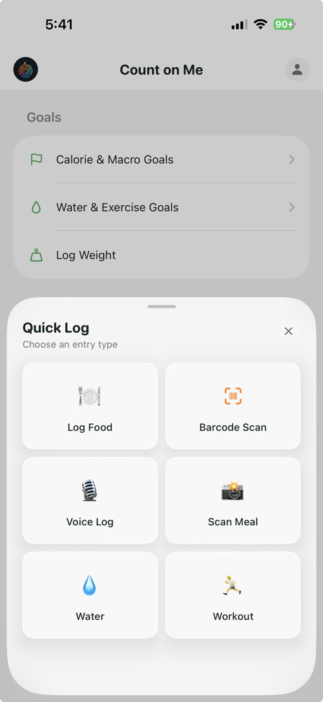 | 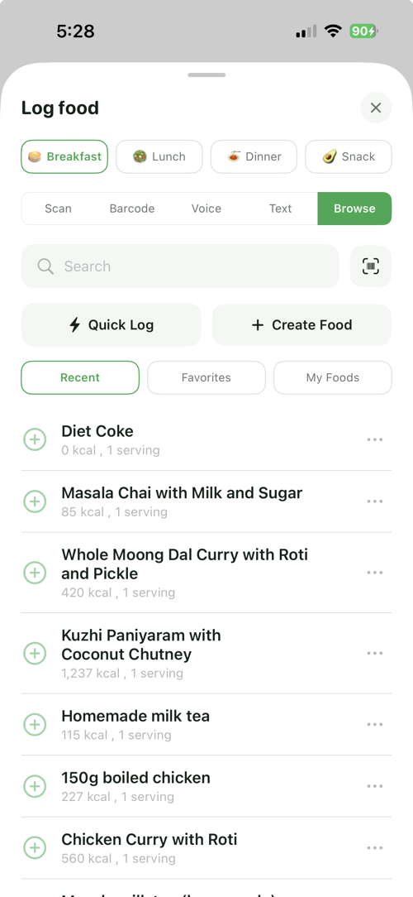 | 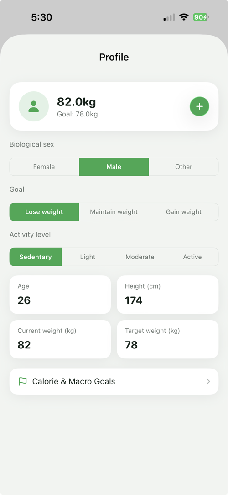 |

| BMI gauge | Water history | Settings |
|---|---|---|
| 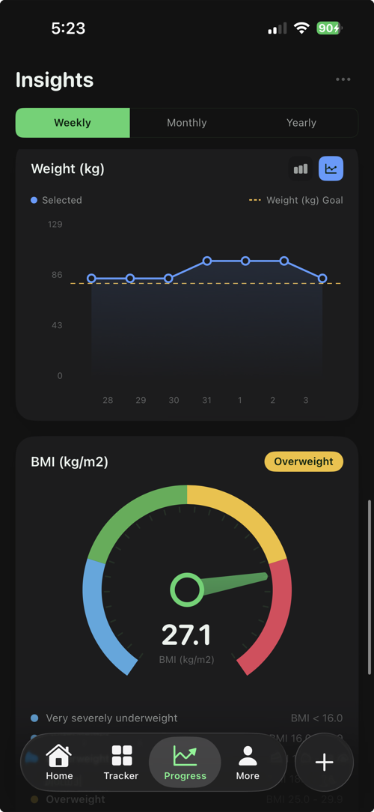 | 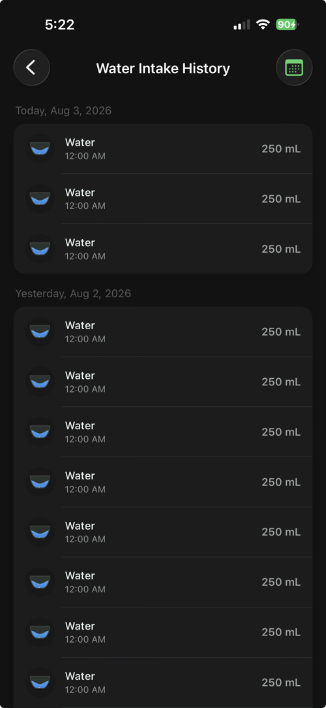 | 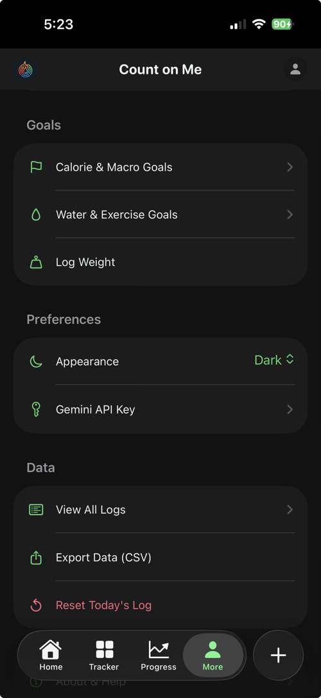 |

## How logging a meal works

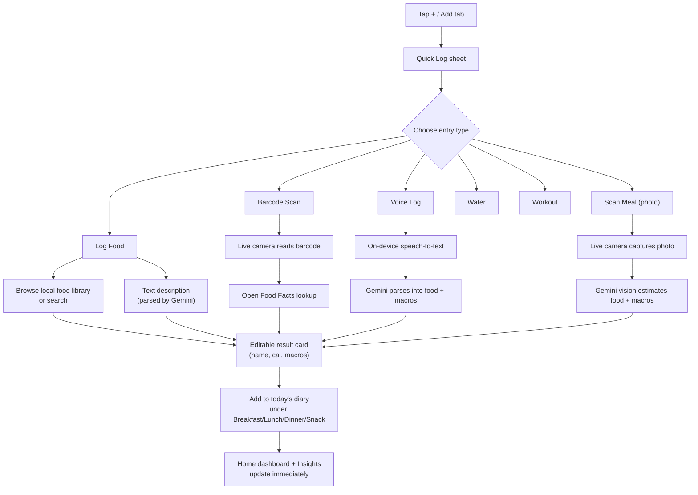

## Requirements

- macOS with **Xcode 26** or later (the project targets iOS 26.0)
- [XcodeGen](https://github.com/yonaskolb/XcodeGen) — the `.xcodeproj` is generated from [`CalorieTracker/project.yml`](CalorieTracker/project.yml) and is not meant to be hand-edited
  ```bash
  brew install xcodegen
  ```
- An Apple ID / Apple Developer account for code signing (a free personal team is enough to run on your own device or the Simulator)
- A physical iPhone or the iOS Simulator running iOS 26+

## Getting the project running

1. **Generate the Xcode project:**
   ```bash
   cd CalorieTracker
   xcodegen generate
   ```
   Re-run this any time a file is added/removed/renamed on disk, or `project.yml` changes — the `.xcodeproj` is a build artifact, not source of truth.

2. **Set your own signing team.** [`project.yml`](CalorieTracker/project.yml) currently has a specific `DEVELOPMENT_TEAM` id under `settings.base`. Replace it with your own Apple Developer Team ID (Xcode → Settings → Accounts, or `xcrun` if you have one configured), then re-run `xcodegen generate`. Alternatively, open the generated project in Xcode and change the team in the target's **Signing & Capabilities** tab — but that change will be overwritten the next time `xcodegen generate` runs, so updating `project.yml` is the durable fix.

3. **Open and run:**
   ```bash
   open CalorieTracker.xcodeproj
   ```
   Select the `CalorieTracker` scheme and either your iPhone or a simulator, then Run (⌘R).

   Or from the command line:
   ```bash
   xcodebuild -project CalorieTracker.xcodeproj -scheme CalorieTracker \
     -destination 'generic/platform=iOS Simulator' -configuration Debug build
   ```

## The Gemini API key

AI food recognition (photo scan, voice log, free-text log) is powered by the Gemini API. **There is no key baked into the app or checked into this repo** — each user supplies their own, entered at runtime and stored securely in the iOS Keychain (see [`KeychainStore.swift`](CalorieTracker/CalorieTracker/Services/KeychainStore.swift)). This keeps the key off disk in source control and scoped to the device it's entered on.

To use those features:

1. Get a free key from [Google AI Studio](https://aistudio.google.com/apikey).
2. In the app, go to **More → Gemini API Key** (or the person icon → Profile → API key settings), paste the key, and tap **Save key**.

Without a key, everything else in the app works normally — manual entry, the local food library/browse search, and barcode scanning (Open Food Facts) don't require any API key. Only **Scan Meal** (photo) and **Voice Log**/**Text** parsing need Gemini.

## Other integrations (no setup required)

- **Open Food Facts** — barcode lookups hit the public `world.openfoodfacts.org` API anonymously; no key needed.
- **HealthKit** — used only to read step count for the dashboard's Steps widget. The app requests permission on first use; declining just leaves that widget empty. Entitlement is already declared in [`CalorieTracker.entitlements`](CalorieTracker/CalorieTracker/Resources/CalorieTracker.entitlements).
- **Speech/microphone** — used for Voice Log; requests on-device permission the first time you use it.

All of the above permission strings (camera, microphone, speech recognition, photo library, HealthKit) are already declared in [`project.yml`](CalorieTracker/project.yml) and get written into `Info.plist` by XcodeGen — no manual Info.plist editing needed.

## Project structure

```
CalorieTracker/
  project.yml                 # XcodeGen spec — edit this, not the .xcodeproj
  CalorieTracker/
    CalorieTrackerApp.swift   # App entry point, SwiftData ModelContainer setup
    Theme.swift               # Colors, fonts, glass-card styling
    Models/                   # SwiftData @Model types (MealEntry, FoodItem, UserProfile, ...)
    Services/                 # Gemini, Open Food Facts, HealthKit, Keychain, barcode/camera capture
    Views/
      Onboarding/             # First-run profile setup flow
      Home/                   # Dashboard tab
      Diary/                  # Meal-by-meal daily diary tab
      Progress/               # Weight trend, daily intake chart, streaks tab
      More/                   # Settings, history/logs, profile, goals
      Components/             # Shared UI (sheets, pills, stat tiles, glass cards, ...)
```

## Data storage

All logs (food, exercise, weight, water) and the user profile are stored locally on-device via SwiftData — there is no backend server and no account system. Data does not sync across devices. Use **More → Export Data (CSV)** to get a copy of your logs.
